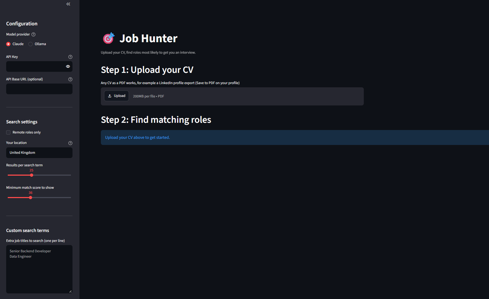

# Job Hunter

An AI-powered job search assistant built with Python and Streamlit. Upload your CV as a PDF, and it searches job boards, scores each role against your profile, and ranks them by fit — so you spend time on the right applications, not scrolling through noise.



---

## Features

- **CV Parsing** — upload your CV as a PDF (a LinkedIn profile export works); the model extracts your skills, experience, seniority, and domains into a structured profile
- **Multi-Board Search** — queries Remotive, Jobicy, and LinkedIn using job titles derived from your CV (your current title, the next step up, and recent past roles), so it works for any profession
- **Location-Aware** — enter a city or country (e.g. `Dublin, Ireland`) and remote roles restricted to other countries are filtered out; leave it blank to see everything
- **AI Scoring** — the model scores each job 0-100 against your profile, with skills match, seniority match, domain match, strengths, gaps, and a fit summary
- **Interview Probability** — low / medium / high / very high rating per role
- **Ranked Results** — roles ranked by score with colour-coded scores (green 75+, amber 55-74, red <55), a minimum-score filter, and tabs for All matches, Recommended, Saved and Applied
- **Save & Track** — save roles, mark as applied, export results to CSV
- **Profile Persistence** — parsed profile cached locally; no need to re-upload CV each session
- **Choice of model** — Claude by default, or a free local model via [Ollama](https://ollama.com)
- **Configurable LLM Gateway** — Base URL field supports internal LLM proxies alongside the standard Anthropic API
- **Custom Search Terms** — add your own job titles alongside auto-generated ones
- **Windows Desktop Mode** — launch silently in Edge app mode with no terminal window

---

## Project Structure

```
job-hunter/
├── app.py                  # Streamlit application (main entry point)
├── llm.py                  # Model provider layer (Claude or Ollama)
├── resume_parser.py        # PDF text extraction and LLM-based parsing
├── scraper.py              # Job board scraping (Remotive, Jobicy, LinkedIn)
├── scorer.py               # LLM-based job scoring
├── tests/
│   └── test_scraper.py     # Unit tests for search terms and location filtering
├── requirements.txt        # Python dependencies
├── ruff.toml               # Ruff linter configuration
├── .env.example            # Environment variable template
├── run.bat                 # Windows launcher (headless)
├── run.vbs                 # VBScript wrapper to suppress terminal
├── create_shortcut.ps1     # PowerShell script to create desktop shortcut
├── static/
│   ├── manifest.json       # PWA manifest
│   ├── sw.js               # Service worker
│   └── icon.ico            # App icon
├── docs/
│   └── screenshot.png      # Application screenshot
├── .github/
│   ├── workflows/
│   │   ├── ci.yml          # CI: ruff lint, import check, unit tests
│   │   └── launcher-integrity.yml
│   └── dependabot.yml      # Weekly pip dependency updates
└── .streamlit/
    └── config.toml         # Streamlit configuration
```

---

## Prerequisites

- **Python 3.11+**
- One of:
  - **Anthropic API Key** — get one at [console.anthropic.com](https://console.anthropic.com), or
  - **[Ollama](https://ollama.com)** installed locally (free, see [Using a free local model](#using-a-free-local-model-ollama))

---

## Installation

```bash
git clone https://github.com/Briancoughlin/job-hunter.git
cd job-hunter
pip install -r requirements.txt
pip install python-jobspy --no-deps
```

> **Note:** `python-jobspy` pins an older numpy that has no prebuilt wheels for Python 3.12+. Using `--no-deps` skips that constraint — it works correctly at runtime.

---

## Configuration

Copy the example environment file and add your API key:

```bash
cp .env.example .env
```

Edit `.env`:

```env
ANTHROPIC_API_KEY=sk-ant-...your-key-here...
# Optional: set this if your organisation has an internal LLM gateway
# ANTHROPIC_BASE_URL=https://your-llm-gateway.example.com

# To use a free local model instead:
# LLM_PROVIDER=Ollama
# OLLAMA_MODEL=llama3.1:8b
# OLLAMA_BASE_URL=http://localhost:11434
```

Or enter your API key directly in the sidebar when the app is running. The key is saved to `.env` for future sessions.

---

## Choosing a model provider

| | Claude (default) | Ollama (local) |
|---|---|---|
| Cost | Pay per use via the Anthropic API | Free |
| Scoring quality | Best. Calibrated scores, specific strengths and gaps | Noticeably weaker with small models; scores are less consistent |
| Speed | A few seconds per role | Depends on your hardware; slow on a laptop without a GPU |
| Privacy | CV text and job ads are sent to the Anthropic API | Nothing leaves your machine |

Switch between them with the **Model provider** toggle at the top of the sidebar. Your choice is saved to `.env`.

### Using a free local model (Ollama)

1. Install Ollama from [ollama.com/download](https://ollama.com/download) (Windows, macOS, Linux)
2. Pull a model:
   ```bash
   ollama pull llama3.1:8b
   ```
3. Make sure Ollama is running (it starts automatically after install; otherwise run `ollama serve`)
4. In the app sidebar, choose **Ollama**. The defaults (`llama3.1:8b` at `http://localhost:11434`) work for a standard install; change the model name to any model you have pulled

**Which model?** An 8B model such as `llama3.1:8b` or `qwen2.5:7b` needs about 8 GB of RAM and is the practical minimum. Very small models (around 3B, e.g. `llama3.2`) run on almost anything but often return vague or badly calibrated scores. If your machine can handle it, a 14B+ model gets closer to Claude's quality.

> **Be aware:** local models score less accurately than Claude. Treat their rankings as a rough first filter and read the roles yourself before ruling any out.

---

## Running the App

```bash
python -m streamlit run app.py
```

Opens at [http://localhost:8501](http://localhost:8501).

To run the tests:

```bash
pip install pytest
python -m pytest tests
```

---

## Windows Desktop Mode

Launch Job Hunter silently in its own Edge window — no terminal, no browser tabs.

1. Create the Start/taskbar shortcut (once, after cloning):
   ```powershell
   .\create_shortcut.ps1
   ```
2. Right-click **Job Hunter.lnk** → **Pin to Start** or **Show more options** → **Pin to taskbar**

Clicking the shortcut starts Streamlit in the background and opens Edge in app mode.

> **Security:** `run.bat`, `run.vbs`, and `create_shortcut.ps1` are version-controlled, and a CI check flags any change to them for review.

---

## Usage

1. Choose a model provider in the sidebar. For Claude, enter your Anthropic API key; for Ollama, check the model name and URL (or set them in `.env`)
2. Upload your CV as a PDF. A LinkedIn profile export works: on your profile, open **More → Save to PDF** (the menu location varies)
3. Adjust search settings: remote only, location, results per term, minimum score
4. Add optional custom search terms (e.g. `Data Engineer`); terms are otherwise derived from the job titles in your CV
5. Click **Search & Score Jobs**
6. Browse ranked results — green (75+), amber (55-74), red (<55)
7. Save roles, mark as applied, or export to CSV

Your parsed profile is cached as `saved_profile.json` — no need to re-upload your CV each session.

---

## Tech Stack

| Component | Purpose |
|-----------|---------|
| Python | Backend logic |
| Streamlit | Web UI |
| Claude (Anthropic) | CV parsing and job scoring (default) |
| Ollama | Optional free local alternative for parsing and scoring |
| Remotive / Jobicy / LinkedIn | Job board sources |
| pdfplumber | PDF text extraction |
| pandas | Data manipulation |
| ruff | Linting |

---

## Contributing

See [CONTRIBUTING.md](CONTRIBUTING.md).

---

## Security

See [SECURITY.md](SECURITY.md).

---

## Licence

MIT. See [LICENSE](LICENSE).
